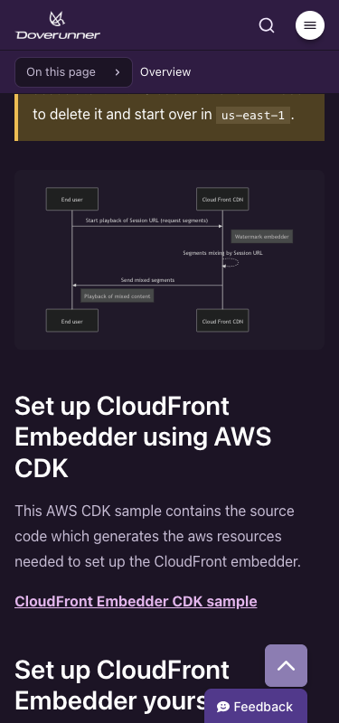
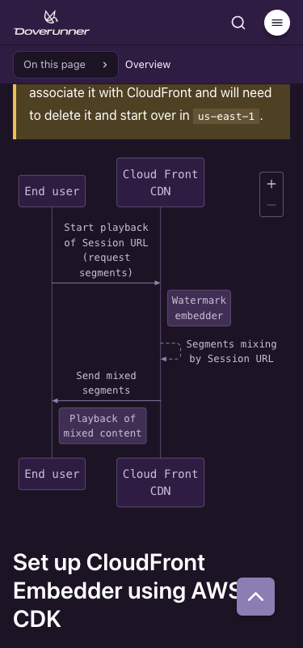

**What you'll get from this post**

- How I fixed [Mermaid](https://mermaid.js.org/) diagrams that shrink to unreadable size on narrow screens by switching to [Pele](https://pele.run/), which recalculates the layout for the container width. It includes before-and-after captures at 375px.
- What to do before you swap a renderer: how to measure each diagram's natural width in the browser to find the ones that will struggle on a small screen, and how to remove hard-coded colors (`classDef`) from the diagram code and move them to CSS so dark mode works.

**Good fit:** you run a Markdown-based docs site with many Mermaid diagrams and worry about how they read on phones.

**Not for you:** you need the SVG pre-rendered at build time. The width-aware layout only worked in the browser.

Our docs site ([docs.doverunner.com](https://docs.doverunner.com)) has 84 Mermaid diagrams across English and Korean. Anything with many steps, like a license issuance flow or a watermarking workflow, is faster to follow as a picture than as prose. But when the screen gets narrow, Mermaid scales the whole diagram down to fit, and the wide ones ended up with text too small to read. Opened on a phone, the pictures that were supposed to carry the explanation couldn't be read.

## What Pele does differently

Pele is an open-source (MIT) library developed for [Obsidian](https://obsidian.md/). It takes Mermaid syntax and draws the SVG with its own layout engine. I cared most that it recalculates the layout for the container width. Mermaid shrinks a finished drawing, but Pele can turn a wide left-to-right flowchart into a top-to-bottom one when the container is narrower than its default of 640px. Its site also says the bundle is 230 kB gzipped against 1.6 MB for Mermaid.js, but I didn't measure that myself.

I found Pele, then asked [Claude Code](https://claude.com/product/claude-code) to review it. I wanted two questions answered before adopting it: would our existing diagrams break on syntax differences, and would they actually read better on a narrow screen?

## Testing against our real diagrams

Claude Code first rendered the 42 English diagrams in Node, and all of them came out without errors. After that it built a pilot on three pages. A code fence marked `mermaid pele` went through Pele and everything else stayed on the old path, so backing out would have been easy.

I compared the pilot against production side by side at 375px. On the [CloudFront](https://aws.amazon.com/cloudfront/) embedder guide, the sequence diagram in production was a small box with tiny text. With Pele it filled the column and I could read it. The flip from horizontal to vertical applies to flowcharts. This capture shows a sequence diagram being drawn to fit the column width.

| Before (Mermaid, production) | After (Pele) |
|---|---|
|  |  |

One thing differed from what I'd assumed. I expected to pre-render the SVG at build time, but the layout can only adapt if Pele knows the container width, and that's only known in the browser. You can call `render()` in Node to get an SVG. There it can't use the browser's real font, so it sizes text with Pele's built-in width estimates and gives you one fixed layout at slightly wrong sizes. The browser's `mount()` function, which draws a diagram into an element, measures text with the CSS font and redraws whenever the container width changes. So the [remark](https://github.com/remarkjs/remark) plugin, which converts the Markdown, only rewrites each code fence into a `<pre>`, and a small script loads Pele on pages that have a diagram and calls `mount()`.

## The dark-mode color problem

Once the pilot worked, we switched every code fence to Pele and rendered all 84 diagrams in the browser at 375px to check that none overflowed sideways. Colors took the most effort. Our diagrams used `classDef` to give step, optional, decision, and action nodes their own light blue, orange, pink, and green fills (24 lines across both languages). Pele applies those as inline styles exactly as written. They were picked for a light background, so in dark mode the dark text sat inside bright boxes and looked wrong.

We now strip `classDef`, `style`, and `%%{init}%%` from each diagram right before rendering. Only class names like `:::step` stay, and CSS supplies the colors. The light and dark palettes are separate. The Mermaid source itself is unchanged, so anyone editing the docs has nothing new to learn.

## What we gained

All 84 diagrams render with Pele, none of them causes horizontal scrolling at 375px, and light and dark mode each use a palette built from the same colors. The `astro-mermaid` and `mermaid` dependencies are gone. The Markdown copies of our pages (`.md`) still contain each diagram as a plain Mermaid code block, so an AI agent reading the docs can still read the diagram as text.

## If you're planning a similar switch

Here's the order I'd suggest.

1. **Measure natural widths first.** Compare each rendered SVG's `viewBox` width (the coordinate area the drawing occupies) with your content column and you get a number for which diagrams will struggle on small screens. Measure in the browser with `mount()`, though. I first measured in Node, where Pele estimates text widths, and the numbers came out about 8% too small. I re-measured in the browser and corrected them.
2. **Put colors in CSS, not in the diagram.** To support dark mode, remove hard-coded colors like `classDef` and keep only the class names.
3. **Check the diagram source after the switch too.** A diagram that's too wide is hard to read in any renderer. Changing direction or shortening labels may do more than a renderer setting.

## Conclusion

What helped most was the three-page pilot and measuring in the browser instead of trusting estimates. Colors now live in CSS rather than in each diagram, so anyone editing the docs only touches the Mermaid code.

### References

- [Pele](https://pele.run/), official site and compatibility notes
- [obsidianmd/pele](https://github.com/obsidianmd/pele) on GitHub
